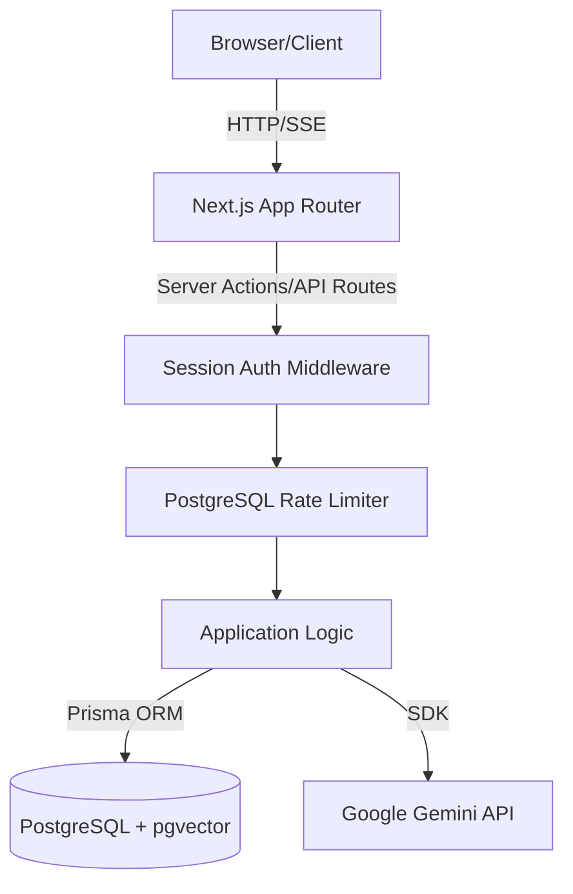
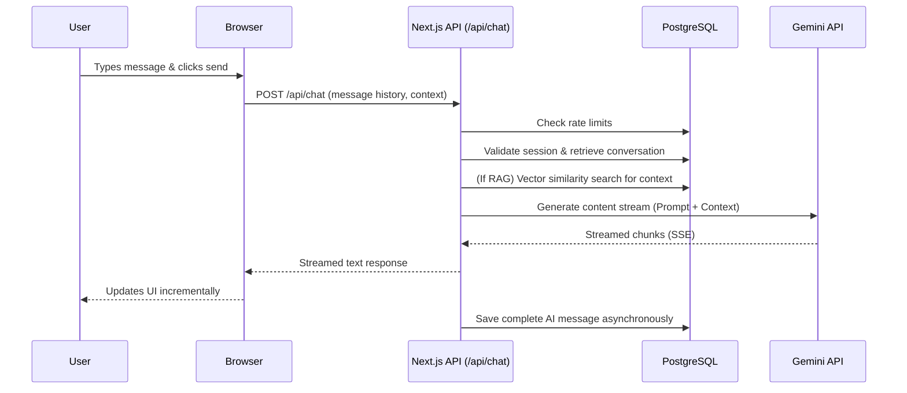

# Vortex: AI Chat Assistant

Vortex is a responsive, full-stack AI chat application built to demonstrate modern web development practices, AI integration, and robust software architecture.

## Overview and Problem Solved
Traditional static web applications often lack intelligent, context-aware interaction. Vortex solves this by providing a seamless conversational interface powered by Google's Gemini API. It enables users to have interactive, intelligent dialogues, analyze uploaded documents via Retrieval-Augmented Generation (RAG), and maintain conversational context securely.

## Key Features
### Implemented
- **Conversational AI:** Real-time streaming responses powered by Gemini 2.5 Flash via Server-Sent Events (SSE).
- **Retrieval-Augmented Generation (RAG):** Upload PDFs and TXT files, chunk and embed them using `text-embedding-004`, and query them contextually.
- **Secure Anonymous Sessions:** Conversational history and RAG documents are strictly scoped to an anonymous browser session (`chat_session_id`), preventing IDOR vulnerabilities.
- **Rate Limiting:** Custom PostgreSQL-based rate limiting to prevent abuse without requiring a separate Redis cluster.
- **Responsive UI:** Dark/Light mode theme, modern interface built with Tailwind CSS and `shadcn/ui`.
- **Markdown Rendering:** Proper rendering of AI responses including code blocks via `react-markdown`.

### Planned
- User authentication and persistent cross-device account history.
- Voice-to-text input and text-to-speech output.
- Web search integration to augment LLM knowledge with live data.

## Technology Stack
- **Frontend:** Next.js 15 (App Router), React 19, Tailwind CSS, `shadcn/ui`, Radix UI, Lucide React.
- **Backend:** Next.js Route Handlers (Serverless).
- **Database:** PostgreSQL (Vercel Postgres/Neon) with `pgvector` extension.
- **ORM:** Prisma v5.
- **AI/LLM:** Google Gemini API (`@google/genai`).
- **Testing:** Vitest, React Testing Library, JSDOM.

## Architecture Overview
Vortex uses a Serverless Next.js architecture. The frontend initiates requests to backend Route Handlers, which enforce rate limits, manage sessions, and securely communicate with the database and Google's Gemini API. Background tasks, such as document processing (parsing, chunking, embedding), leverage `@vercel/functions` (`waitUntil`) to execute without blocking the main request thread.

### Architecture Diagram

### Conversation Request Flow

## Database Schema Overview
The database uses PostgreSQL with the `pgvector` extension. Key models include:
- `Conversation`: Groups messages. Linked to a `sessionId`.
- `Message`: Individual chat messages (user or assistant). Tracks status (`completed`, `failed`).
- `Document`: Metadata for uploaded files (PDF/TXT) scoped to a `sessionId`.
- `DocumentChunk`: Text chunks from documents with `vector` embeddings for similarity search.
- `RateLimit`: Tracks API usage per endpoint/session.

## AI Provider Integration & Context Strategy
Vortex utilizes the official `@google/genai` SDK. To protect API keys, all AI integrations occur server-side (`server-only`). Conversational context is maintained by passing the last 50 messages of the conversation to the model, ensuring the AI can reference recent dialogue without exceeding token limits.

## RAG Architecture and Limitations
RAG is implemented natively within the application. Uploaded PDFs are parsed using `pdf-parse`, chunked, and embedded via Gemini's `text-embedding-004`. The embeddings are stored in PostgreSQL using `pgvector`.
* **Limitations:** PDF parsing is currently done in memory in the Next.js process, which may struggle with very large PDFs in a constrained serverless environment. Background processing relies on `waitUntil`, which has execution time limits on standard Vercel plans (10s-60s).

## Local Setup

1. **Clone the repository and install dependencies:**
   `git clone <repo-url>`
   `cd vortex`
   `npm install --legacy-peer-deps`

2. **Configure Environment Variables:**
   `cp .env.example .env.local`
   *Fill in `DATABASE_URL` (requires a pgvector-enabled Postgres DB) and `GEMINI_API_KEY`.*

3. **Database Migration:**
   `npx prisma migrate dev`

4. **Start Development Server:**
   `npm run dev` (run in background if needed)

## Environment Variable Reference
- `DATABASE_URL`: Full connection string to the PostgreSQL database.
- `GEMINI_API_KEY`: API key from Google AI Studio.
- `GEMINI_MODEL`: (Optional) Specifies the Gemini model (defaults to `gemini-2.5-flash`).

## Testing
The project features comprehensive unit and integration tests using Vitest.
To run tests:
`npm run test`

To run linting and typechecking:
`npm run lint`
`npm run typecheck`

## Deployment
Vortex is optimized for Vercel deployment. Ensure you link a PostgreSQL database (like Vercel Postgres or Supabase) and configure the `DATABASE_URL` and `GEMINI_API_KEY` in your Vercel Project Settings. Build command: `npm run build`.

## Security and Privacy
- **Anonymous Sessions:** Users are assigned an anonymous UUID cookie (`chat_session_id`). All database queries require this ID, inherently preventing Insecure Direct Object Reference (IDOR) across users.
- **Prompt Injection Defense:** Uploaded document content is strictly passed as user context, not system instructions, to mitigate basic prompt injection vectors.
- **Secrets Management:** The Gemini API key is isolated server-side.

## Known Limitations
- RAG does not currently support complex tabular data extraction from PDFs.
- Long conversations over 50 messages will have earlier context truncated to preserve token efficiency.
